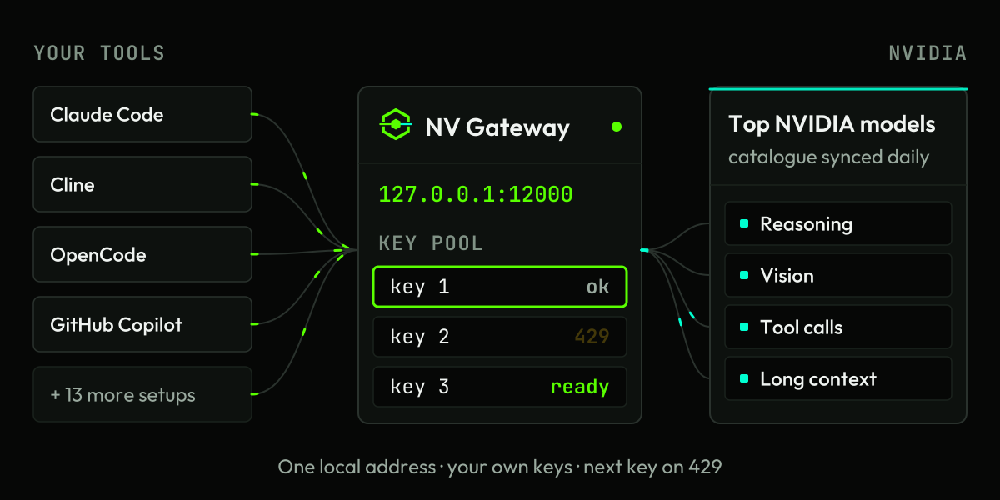
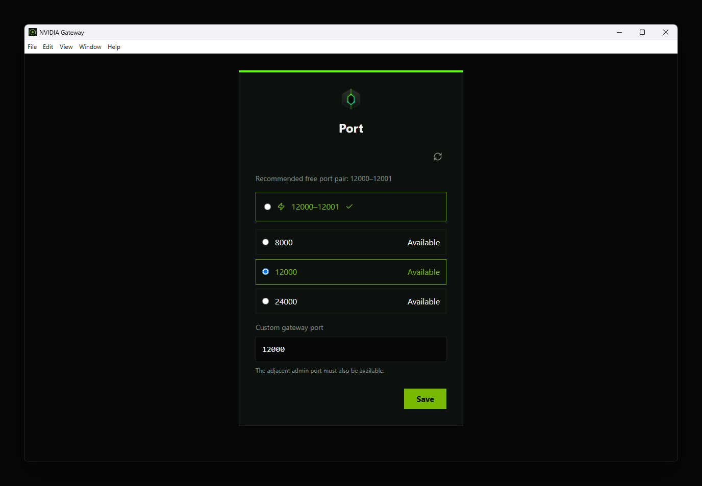
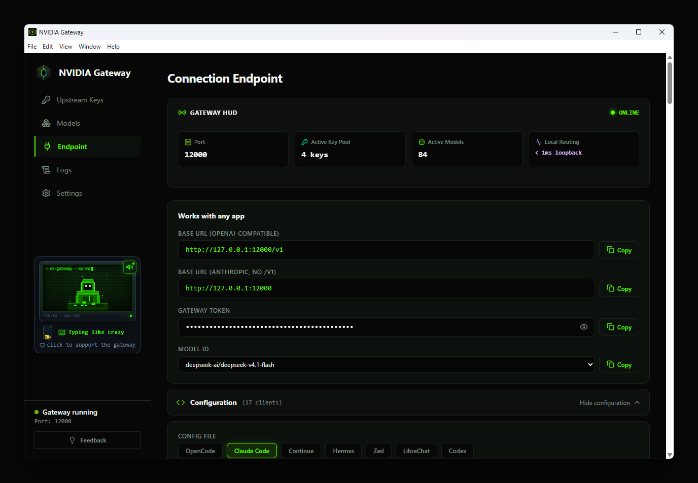
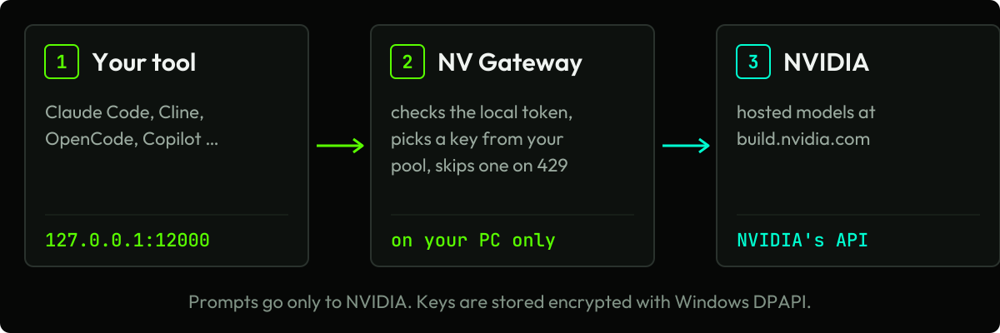

<p align="center"><a href="README.ru.md">Русский</a> · English</p>

<p align="center"><picture>
  <source media="(prefers-color-scheme: dark)" srcset="docs/assets/logo-dark.svg">
  </picture></p>

<h1 align="center">NV Gateway: OpenAI &amp; Anthropic API for NVIDIA NIM</h1>

<p align="center">A free Windows app that gives Claude Code, Cline, OpenCode and 14 more setups one local address: <code>127.0.0.1:12000</code>.</p>

<p align="center"><b>Works with your NVIDIA Build API keys (build.nvidia.com).</b></p>

<p align="center">
  <a href="https://github.com/HaYkMnE/NV-Gateway/releases/latest"></a>
  <a href="https://github.com/HaYkMnE/NV-Gateway/releases"></a>
  
  <a href="LICENSE"></a>
  <a href="https://scorecard.dev/viewer/?uri=github.com/HaYkMnE/NV-Gateway"></a>
</p>

<p align="center"><a href="https://github.com/HaYkMnE/NV-Gateway/releases/latest"></a></p>

**Recommended: install with one command (no browser warning).** Paste into PowerShell:

```powershell
irm https://raw.githubusercontent.com/HaYkMnE/NV-Gateway/main/install.ps1 | iex
```

<sub>Installing from PowerShell skips the browser download warning and the SmartScreen prompt. Microsoft Defender still scans the installer. <a href="#install">Other ways to install</a></sub>

<p align="center"><b>Free and open source (Apache-2.0)</b> · <b>No admin rights</b> · <b>Keys stored on your PC</b></p>

<p align="center"><sub>Windows 10 and later · SHA256SUMS.txt in every release</sub></p>

<p align="center"><a href="#why-nv-gateway">Why</a> · <a href="#quick-start-in-4-steps">Quick start</a> · <a href="#install">Install</a> · <a href="#everything-included">Features</a> · <a href="#works-with-your-tools">Works with</a> · <a href="#how-it-compares">Compare</a> · <a href="#privacy-exactly-what-goes-where">Privacy</a> · <a href="#open-source">Open source</a> · <a href="#faq">FAQ</a> · <a href="#for-developers">Developers</a> · <a href="README.ru.md">Русский</a></p>

<p align="center"></p>

## Why NV Gateway

- **One address for every tool.** 17 ready setups, including Claude Code, Cline, Roo Code, Kilo Code, OpenCode, Codex CLI, Copilot and Open WebUI.
- **A limit on one model doesn't stop your other models.** Works with one key or many. NV Gateway tracks rate limits for each model separately: if a key hits a limit on one model, it stays available for your other models, and the request moves on to another key.
- **Three APIs, one port.** OpenAI Chat Completions, Anthropic Messages and OpenAI Responses at `127.0.0.1:12000`. Claude Code and Codex CLI work directly.
- **Real limits, not guesses.** For models with a tuned profile, `/v1/models` reports context and output size, up to 1M tokens, so your tool stops cutting prompts short.
- **Top NVIDIA models, always current.** The app syncs NVIDIA's catalogue daily, so new models show up without an update. Tuned profiles add reasoning levels, image input and tool calls where the model supports them.
- **Local and locked down.** Listens on 127.0.0.1 only, needs a local token, and stores keys encrypted with Windows DPAPI. Keys are kept out of logs.
- **No admin rights.** A per-user installer with a first-run wizard. It comes back by itself if it crashes (up to 3 restarts).
- **Free and open source (Apache-2.0), no account with us, no telemetry.** 7 interface languages. Updates install only when you accept them. You still need an NVIDIA account for keys.

## Quick start in 4 steps

1. **Install** with one command in PowerShell: `irm https://raw.githubusercontent.com/HaYkMnE/NV-Gateway/main/install.ps1 | iex`. It checks the installer's SHA256 and installs it for your user, with no admin rights. Prefer a browser download? See [Install](#install).
2. **Get a free key** at [build.nvidia.com](https://build.nvidia.com).
3. **Paste your key** in the first-run wizard and select your local port (default: `12000`).
4. **Point your tool** at `http://127.0.0.1:12000/v1`. For Claude Code, use `ANTHROPIC_BASE_URL=http://127.0.0.1:12000`, without `/v1`. Copy the gateway token from the app's **Endpoint** screen and use it as the API key.

<p align="center"></p>

<p align="center"><a href="https://github.com/HaYkMnE/NV-Gateway/releases/latest"></a></p>

## Works with your tools

Use the port shown in the app (12000 by default). Copy the generated **Gateway Token** from the app's **Endpoint** screen; `<gateway-token>` below stands for it and is not a working credential.

| Tool | Protocol | Base URL |
|---|---|---|
| Claude Code | Anthropic Messages | `http://127.0.0.1:12000` (no `/v1`) |
| Codex CLI | OpenAI Responses | `http://127.0.0.1:12000/v1` |
| OpenCode | OpenAI Chat Completions | `http://127.0.0.1:12000/v1` |
| Cline / Roo Code | OpenAI Compatible | `http://127.0.0.1:12000/v1` |
| Aider | OpenAI Chat Completions | `http://127.0.0.1:12000/v1` |
| Continue | OpenAI Chat Completions | `http://127.0.0.1:12000/v1` |
| Windsurf / OpenClaw | OpenAI | `http://127.0.0.1:12000/v1` |
| Cursor | OpenAI | `http://127.0.0.1:12000/v1`. Needs a paid Cursor plan and a public tunnel, because Cursor cannot reach localhost. |

The app has setups for 9 more, including Kilo Code, Zed, GitHub Copilot and Open WebUI. For OpenCode it can write the config into `~/.config/opencode/opencode.json` for you.

<details>
<summary>Claude Code</summary>

```powershell
$env:ANTHROPIC_BASE_URL = "http://127.0.0.1:12000"
$env:ANTHROPIC_AUTH_TOKEN = "<gateway-token>"
claude --model <model-id>
```

Bash/Zsh:

```bash
export ANTHROPIC_BASE_URL="http://127.0.0.1:12000"
export ANTHROPIC_AUTH_TOKEN="<gateway-token>"
claude --model <model-id>
```
</details>

<details>
<summary>Codex CLI (<code>%USERPROFILE%\.codex\config.toml</code>)</summary>

```toml
model = "<model-id>"
model_provider = "nv-gateway"

[model_providers.nv-gateway]
name = "NV-Gateway"
base_url = "http://127.0.0.1:12000/v1"
env_key = "NV_GATEWAY_TOKEN"
wire_api = "responses"
```

Then set `$env:NV_GATEWAY_TOKEN = "<gateway-token>"` and run `codex`.
</details>

<details>
<summary>Aider</summary>

```powershell
$env:OPENAI_API_BASE = "http://127.0.0.1:12000/v1"
$env:OPENAI_API_KEY  = "<gateway-token>"
aider --model openai/<model-id>
```

Bash/Zsh:

```bash
export OPENAI_API_BASE="http://127.0.0.1:12000/v1"
export OPENAI_API_KEY="<gateway-token>"
aider --model openai/<model-id>
```
</details>

Replace `<model-id>` with any model from the app's **Models** screen. Your tool can also fetch the current list with `GET /v1/models`.

<p align="center"></p>

## Everything included

<details>
<summary><b>Keys</b></summary>

- **A limit on one model doesn't block that key for your other models.** Per-model key handling.
- **Bad keys are caught before they are saved.** Each key is checked with NVIDIA when you add it.
- **See how each key is doing.** Per-key counters for successes, failures and tokens.
- **Pause a key without deleting it.** Per-key on/off switch.
- **See which models your keys can reach.** Each model card shows how many of your keys can use it.

</details>

<details>
<summary><b>Models</b></summary>

**Capabilities, where the model supports them:** Reasoning · Vision · Tool calls · Long context

- **New NVIDIA models show up without an app update.** The catalogue refreshes every 24 hours.
- **Find strong models first.** Sort by strength (Top Rated, from LLM Stats), popularity, name or update date.
- **Show only what you can use.** Filters for models with a free endpoint, or downloadable ones.
- **Check a model at a glance.** Badges show NVIDIA's free-endpoint and downloadable flags.
- **See how fresh each entry is.** An age badge shows when NVIDIA last updated the model in its catalogue.
- **Find a model by typing.** Search, with Ctrl+K to jump straight to it.
- **Read the details without leaving the app.** The details panel shows capabilities, availability, update date and popularity.
- **Test a model without any client.** Copy a ready cURL command.
- **Keep your tools' model list short.** Turn a model off and it disappears from `/v1/models`.
- **Choose how long to wait, per model.** Day waits up to 300 s for the first byte, Night 120 s, and Auto picks from recent timeouts and stream errors.

</details>

<details>
<summary><b>Clients & API</b></summary>

- **Connect 17 client setups from one screen.** Ready setups with copy buttons for the base URL, token and model ID.
- **Skip hand-editing the OpenCode config.** The app writes it, with each model's limits and reasoning flag.
- **Use three APIs on one port.** OpenAI Chat Completions, Anthropic Messages and OpenAI Responses.
- **Claude Code's thinking setting just works.** It maps to the model's reasoning level and is refused clearly when a model can't reason.
- **Track token use while streaming.** Streamed answers report token usage at the end.
- **Stop your tool from cutting prompts short.** `/v1/models` reports context and output limits for models with a tuned profile, up to 1M tokens.

</details>

<details>
<summary><b>Reliability</b></summary>

- **Requests don't wait forever.** Set a total time limit per request; when it runs out, you get a clear timeout error.
- **It recovers from crashes on its own.** Up to 3 automatic restarts.
- **A cut-off reply is never passed off as complete.** A broken upstream stream ends with an error.
- **See where time goes.** Logs show each request's duration, and you can review and send the error list.
- **Report a problem in one file.** Export a diagnostic file to attach to an issue.

</details>

<details>
<summary><b>Privacy & security</b></summary>

- **Nothing on your network can reach it.** It listens on 127.0.0.1 only.
- **Only your apps can use it.** Requests need the local gateway token.
- **Your keys are encrypted on disk.** Windows DPAPI, with keys and tokens removed from logs.
- **A tampered app refuses to run.** ASAR integrity check on the packaged app.
- **Nothing is collected about you.** No telemetry or analytics.

</details>

<details>
<summary><b>Everyday use</b></summary>

- **Stays out of the way.** Runs from the system tray and can start with Windows.
- **Use it in your language.** 7 interface languages, with right-to-left layout for Arabic.
- **Learn the settings as you go.** A small pet in the sidebar shows tips about real settings. Tips can be turned off.
- **Update when you choose.** The app offers updates and installs one only after you accept.
- **Support the project if you want to.** Optional crypto donation.

</details>

## How it compares

As described in each project's README, checked 2026-10-29.

| | NV Gateway | Raw NVIDIA API | LiteLLM | Docker NIM proxies (e.g. nim-proxy) |
|---|---|---|---|---|
| Install | Windows installer + GUI | none (HTTP) | pip / Docker | Docker |
| Installs without admin rights | yes | n/a | — | — |
| Anthropic `/v1/messages` for Claude Code | yes | no | yes | varies |
| Several keys with failover | yes | no, one key per request | yes (config) | yes (nim-proxy) |
| Key pool managed in a GUI | yes, desktop app | n/a | — | web UI in Docker (nim-proxy) |
| Rate limits tracked per model and key | yes | n/a | — | — |
| Model limits sent to tools | yes, for tuned profiles | n/a | config | not stated |
| Listens on 127.0.0.1 only, keys encrypted with DPAPI | yes | n/a | — | — |
| Interface languages | 7 | n/a | — | — |
| Open source | ✓ Apache-2.0 | n/a | ✓ | ✓ |
| Price | free | free tier | free | free |
| Providers | NVIDIA only | NVIDIA | 100+ providers | NVIDIA |

<sub>n/a = not applicable. — = not claimed in their README as of 2026-10-29.</sub>

## How it works

<p align="center"></p>

Your tool sends a request to `127.0.0.1:12000`. NV Gateway translates it if needed, adds one of your NVIDIA keys and sends it to NVIDIA's API. If that key is rate-limited on this model or fails, the request moves on to another key. The answer streams back in the format your tool expects.

## Privacy: exactly what goes where

Prompts go to NVIDIA only. NV Gateway has no telemetry or analytics. The full list is in [PRIVACY.md](PRIVACY.md).

| Destination | What is sent | When | Can you turn it off? |
|---|---|---|---|
| NVIDIA (`integrate.api.nvidia.com`) | Your prompts, with one of your keys; model-list requests; short capability checks | When your tool sends a request, at start, and when you add a key | No, this is what the app is for |
| NVIDIA (`api.ngc.nvidia.com`) | A request for public catalogue data, no key | At start, then when the 24 h cache expires | No |
| GitHub (`HaYkMnE/NV-Gateway`) | An update check | At start and every 6 h | Nothing downloads unless you accept |
| `api.zeroeval.com` (model rankings) | A plain request with no key and no model IDs. The service sees your IP address | At most once per 24 h. **On by default** | Yes: Settings → Model ranking (LLM Stats) |
| Error reports (`nv-gateway-reports.nvgw-sys.workers.dev`) | The redacted error list and the app version | Only when you click **Send** | It never runs unless you click Send |

Your keys are stored encrypted with Windows DPAPI in `%APPDATA%\NV-Gateway\keys.json`. If Windows encryption is unavailable, the app refuses to save keys rather than store them in plain text.

## Install

**A. One command (recommended).** Open PowerShell (no admin rights needed) and run:

```powershell
irm https://raw.githubusercontent.com/HaYkMnE/NV-Gateway/main/install.ps1 | iex
```

The script downloads the latest installer and `SHA256SUMS.txt` from the releases page, stops if the SHA256 does not match, installs for your user only (`/S /currentuser`) and deletes its temp files. It does not ask for admin rights or change any security settings. [Read the script](https://github.com/HaYkMnE/NV-Gateway/blob/main/install.ps1).

**B. Review the script first.**

```powershell
irm https://raw.githubusercontent.com/HaYkMnE/NV-Gateway/main/install.ps1 -OutFile install.ps1
notepad install.ps1
powershell -NoProfile -ExecutionPolicy Bypass -File .\install.ps1
```

`-ExecutionPolicy Bypass` applies only to that one PowerShell process and does not change your saved policy. It is there because many Windows PCs use the Restricted policy, which blocks local scripts.

**C. Download the .exe in your browser.** Get `NV-Gateway-Setup-<version>.exe` from the [latest release](https://github.com/HaYkMnE/NV-Gateway/releases/latest), [verify it](#verify-the-download-sha256), then follow the SmartScreen steps below.

Installing from PowerShell skips the browser download warning and the SmartScreen prompt. Microsoft Defender still scans the installer. If Smart App Control is on (Windows 11), Windows may still block the unsigned installer, whichever way you install it. The checksum comes from the same release, so it catches a damaged or altered download, not a compromised release.

More options, including a manual `curl.exe` path: [INSTALL.md](INSTALL.md).

## "Windows protected your PC"?

This prompt appears when you run the `.exe` downloaded in a browser (option C above).

The installer is not code-signed, so SmartScreen shows "Windows protected your PC" and "Unknown Publisher". Unsigned files start with no reputation, and this repeats for each new version.

1. [Verify the download](#verify-the-download-sha256) first.
2. Click **More info**.
3. Click **Run anyway**.

Some antivirus tools may flag the app for the same reason. Download it only from the [releases page](https://github.com/HaYkMnE/NV-Gateway/releases).

## Verify the download (SHA256)

Each release includes `SHA256SUMS.txt`. Download it from the same release as the installer, into the same folder.

1. Open PowerShell in that folder.
2. Print the installer's hash:

   ```powershell
   Get-FileHash .\NV-Gateway-Setup-*.exe -Algorithm SHA256
   ```

3. Compare it with the line for that file name in `SHA256SUMS.txt`. Case does not matter.

To compare automatically (keep only one installer in the folder):

```powershell
$exe = Get-Item .\NV-Gateway-Setup-*.exe | Select-Object -First 1
$expected = ((Select-String -Path .\SHA256SUMS.txt -Pattern ([regex]::Escape($exe.Name) + '$')).Line -split '\s+')[0]
(Get-FileHash $exe.FullName -Algorithm SHA256).Hash -eq $expected
```

`True` means the file matches. If you see `False`, delete the file and download it again from the releases page.

## Open source

NV Gateway is free and open source under the [Apache License 2.0](LICENSE). The whole app is in this repository, so anyone can audit that your keys stay on your PC: key storage is in [`src/main/secure-state.ts`](src/main/secure-state.ts), and every network destination is listed in [PRIVACY.md](PRIVACY.md).

- **Releases come from this source.** All releases are built by GitHub Actions from this repository ([release workflow](.github/workflows/release.yml)).
- **Checksums.** Every release includes `SHA256SUMS.txt` for the installer, its blockmap, `latest.yml` and the portable zip. See [Verify the download](#verify-the-download-sha256).
- **The licence in plain words.** You may use, modify and distribute NV Gateway for free, including commercially, as long as you include the licence and the NOTICE file and mark the files you changed. Apache-2.0 does not grant permission to use the name "NV Gateway" or its logo, except to describe where the software comes from. Please publish forks under another name. Full terms: [LICENSE](LICENSE), [NOTICE](NOTICE), [THIRD-PARTY-NOTICES.txt](THIRD-PARTY-NOTICES.txt).

## FAQ

<details>
<summary><b>How do I use Claude Code with NVIDIA NIM for free?</b></summary>

Set `ANTHROPIC_BASE_URL=http://127.0.0.1:12000` (without `/v1`) and `ANTHROPIC_AUTH_TOKEN` to the gateway token, then start `claude --model <model-id>`. NVIDIA's hosted API has no Anthropic route, so NV Gateway translates Anthropic Messages requests for it. You need a free NVIDIA API key from build.nvidia.com.
</details>

<details>
<summary><b>How do I use NVIDIA API keys in Cline or Roo Code?</b></summary>

Choose the **OpenAI Compatible** provider, set the Base URL to `http://127.0.0.1:12000/v1` and paste the gateway token as the API key. Your NVIDIA keys stay in NV Gateway. Then enter a model ID from the app's **Models** screen.
</details>

<details>
<summary><b>Why does Cursor not work with my NVIDIA key?</b></summary>

Cursor cannot reach `localhost`, so it needs a paid Cursor plan and a public tunnel to your gateway. Other tools in the list connect to `127.0.0.1` directly.
</details>

<details>
<summary><b>What does "429 Too Many Requests" mean on build.nvidia.com?</b></summary>

It means NVIDIA rate-limited that key. NVIDIA applies per-key rate limits and does not publish one fixed number. Community reports put it at about 40 requests per minute, varying by model ([NVIDIA forum](https://forums.developer.nvidia.com/t/request-for-nvidia-build-api-rate-limit-increase-40-rpm-200-rpm/377433)). If you added more than one key, the request moves on to another key, and the limited key stays available for your other models. When every key is limited, requests fail until a limit resets.
</details>

<details>
<summary><b>Can I use more than one NVIDIA API key?</b></summary>

Yes. Works with one key or many. NV Gateway tracks rate limits for each model separately: if a key hits a limit on one model, it stays available for your other models, and the request moves on to another key. You are responsible for using your keys in line with NVIDIA's terms.
</details>

<details>
<summary><b>Does one rate-limited key block the others?</b></summary>

No. A rate limit is tracked for that key on that one model, so the key keeps working for your other models and the request moves on to another key. A key that NVIDIA rejects, that has run out of credits, or that returns server errors is paused for all models until it recovers.
</details>

<details>
<summary><b>Can I turn off a model or a key?</b></summary>

Yes, both. Switch a key off on the Keys screen without deleting it. Switch a model off on the Models screen, and it is removed from the model list your tools see on their next request.
</details>

<details>
<summary><b>How do new NVIDIA models appear?</b></summary>

Automatically. NV Gateway refreshes NVIDIA's catalogue every 24 hours, so new models show up without an app update. An age badge on each model shows when NVIDIA last updated it.
</details>

<details>
<summary><b>Which models can I use?</b></summary>

Any model in NVIDIA's hosted catalogue. The app shows the current list, and `GET /v1/models` returns it. NVIDIA adds and retires models over time.
</details>

<details>
<summary><b>Can I audit or build it myself?</b></summary>

Yes. NV Gateway is open source under Apache-2.0, and the full source is in this repository. You can read how keys are stored ([`src/main/secure-state.ts`](src/main/secure-state.ts)), check every place the app connects to ([PRIVACY.md](PRIVACY.md)), and build it yourself ([Build from source](DEVELOPMENT.md#build-from-source)). All releases are built by GitHub Actions from this repository.
</details>

<details>
<summary><b>Upgrading from 0.x: why did my app stop updating?</b></summary>

0.x installs check an old address and will not auto-update. Reinstall once with the one-line command from [INSTALL.md](INSTALL.md#option-1-recommended-one-command). Your settings and keys are kept.
</details>

<details>
<summary><b>Does NV Gateway send my prompts or keys anywhere else?</b></summary>

No. Prompts and keys go to NVIDIA only. The app also contacts GitHub for update checks and `api.zeroeval.com` for model rankings (no key, no model IDs, can be turned off), and sends an error report only when you click Send. See [PRIVACY.md](PRIVACY.md).
</details>

<details>
<summary><b>Why does Windows or my antivirus warn about the installer?</b></summary>

Because the installer is not code-signed. NV Gateway is a free project without a paid code-signing certificate, so Windows has no publisher reputation for it, and each new version starts from zero. To check the file, compare its SHA256 with `SHA256SUMS.txt` from the same release ([steps](#verify-the-download-sha256)). To avoid the browser and SmartScreen prompts, install with the [PowerShell command](#install); Microsoft Defender still scans the installer. If Smart App Control is on (Windows 11), Windows may block the unsigned installer whichever way you install it. If Defender flags the file and you believe it is a false positive, you can submit it to Microsoft at https://www.microsoft.com/wdsi/filesubmission/.
</details>

<details>
<summary><b>Which port does NV Gateway use, and can I change it?</b></summary>

It uses 12000 for the API and 12001 for the admin port, which is always the API port plus 1. You choose the port in the first-run wizard. Later, **Settings → Change port** reopens the same step.
</details>

<details>
<summary><b>Does NV Gateway work on macOS or Linux?</b></summary>

No. It runs on Windows 10 and later only.
</details>

<details>
<summary><b>How do I uninstall NV Gateway completely?</b></summary>

Go to Windows **Settings → Apps → NV-Gateway → Uninstall**. This removes the app and the launch-at-sign-in entry. Your encrypted keys, config and logs stay in `%APPDATA%\NV-Gateway`, so a reinstall keeps them. To remove them too, delete that folder after uninstalling.
</details>

<details>
<summary><b>Do I need an NVIDIA account?</b></summary>

Yes. You need an NVIDIA account to create API keys at build.nvidia.com. NV Gateway itself has no account or sign-up.
</details>

## Honest limitations

- Windows only (Windows 10 and later).
- The installer is unsigned, so SmartScreen warns on every new version.
- NVIDIA's free-tier limits apply. When every key is rate-limited, requests fail.
- You are responsible for using your keys in line with NVIDIA's terms.
- NVIDIA can retire a model at any time; the app keeps working with the rest of the catalogue.
- If Smart App Control is on (Windows 11), Windows may block the unsigned installer, whichever way you install it.
- A model that keeps failing is not hidden or marked automatically.
- Cursor needs a paid Cursor plan and a public tunnel.
- No published performance benchmarks.

<p align="center"><a href="https://github.com/HaYkMnE/NV-Gateway/releases/latest"></a></p>

## For developers

Build steps, the full local API reference and the repository layout are in [DEVELOPMENT.md](DEVELOPMENT.md).
Read [AGENTS.md](AGENTS.md) before you change runtime, security, packaging or localisation code.
You need Windows, Git and Node.js 22.12 or later.

<details>
<summary>Quick build, example config and core API routes</summary>

```powershell
git clone https://github.com/HaYkMnE/NV-Gateway.git
cd NV-Gateway
npm ci
npx install-electron --no

# Build the Electron app and gateway bundle
npm run build

# In terminal 1, start the Vite renderer
npm run dev

# In terminal 2, start Electron
npm start
```

To build the unpacked app and run the packaged audits, set the release owner first.

PowerShell:

```powershell
$env:NVGW_GH_OWNER = "HaYkMnE"
npm run package:dir
```

Bash/Zsh:

```bash
export NVGW_GH_OWNER="HaYkMnE"
npm run package:dir
```

Release builds are named `dist/NV-Gateway-Setup-<version>.exe` (installer) and `dist/NV-Gateway <version>.exe` (portable). `<version>` is the `version` field in [`package.json`](package.json).

Example config for OpenCode (the app writes it for you; the model id is only an example):

```jsonc
{
  "$schema": "https://opencode.ai/config.json",
  "provider": {
    "nvidia-gateway": {
      "npm": "@ai-sdk/openai-compatible",
      "name": "NV-Gateway",
      "options": {
        "baseURL": "http://127.0.0.1:12000/v1",
        "apiKey": "<gateway-token>"
      },
      "models": {
        "z-ai/glm-5.2": {
          "name": "GLM-5.2"
        }
      }
    }
  }
}
```

Core routes on the paired loopback ports (default `12000` and `12001`). The effective port is the one shown in the app.

| Endpoint | Port | Auth | Purpose |
| :--- | :--- | :--- | :--- |
| `POST /v1/chat/completions` | `12000` | Gateway Bearer Token | OpenAI chat completions |
| `POST /v1/messages` | `12000` | Gateway Bearer Token | Anthropic Messages API |
| `GET /v1/models` | `12000` | Gateway Bearer Token | Model list with limits |
| `GET /health` | `12000` | Public | Health probe |
| `GET /admin/logs` | `12001` | Admin Token | Recent request events |

</details>

## Contributing

Bug reports, fixes and translations are welcome. Read [CONTRIBUTING.md](.github/CONTRIBUTING.md) and [AGENTS.md](AGENTS.md), run `npm test` before you open a pull request, and never commit keys or tokens.

## Security

Report vulnerabilities privately through GitHub private vulnerability reporting on this repository: [report a vulnerability](https://github.com/HaYkMnE/NV-Gateway/security/advisories/new). Please do not open a public issue for a security problem. Scope and details: [SECURITY.md](.github/SECURITY.md).

## Changelog · Support · License

- **Changelog:** [CHANGELOG.md](CHANGELOG.md) and the [release notes](https://github.com/HaYkMnE/NV-Gateway/releases).
- **Support:** [open an issue](https://github.com/HaYkMnE/NV-Gateway/issues). Remove keys and tokens from any log you paste.
- **License:** free and open source under [Apache-2.0](LICENSE). See [NOTICE](NOTICE) and [THIRD-PARTY-NOTICES.txt](THIRD-PARTY-NOTICES.txt). The name "NV Gateway" and its logo are not licensed.

<sub>NV Gateway is an unofficial, independent app. It is not made, endorsed or supported by NVIDIA. NVIDIA and NIM are trademarks of NVIDIA Corporation.</sub>
