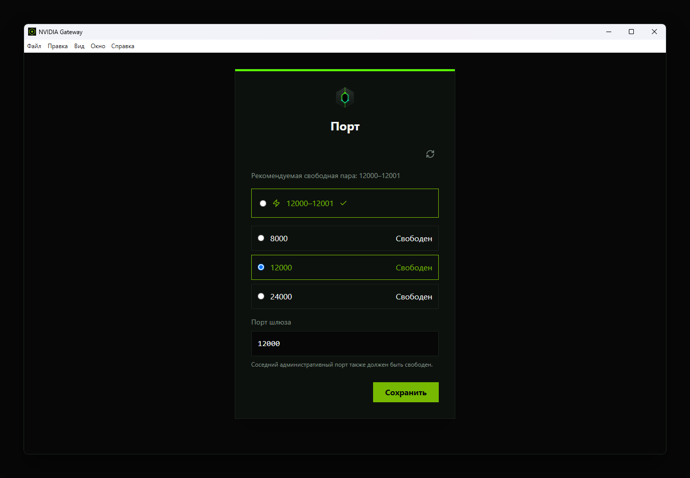
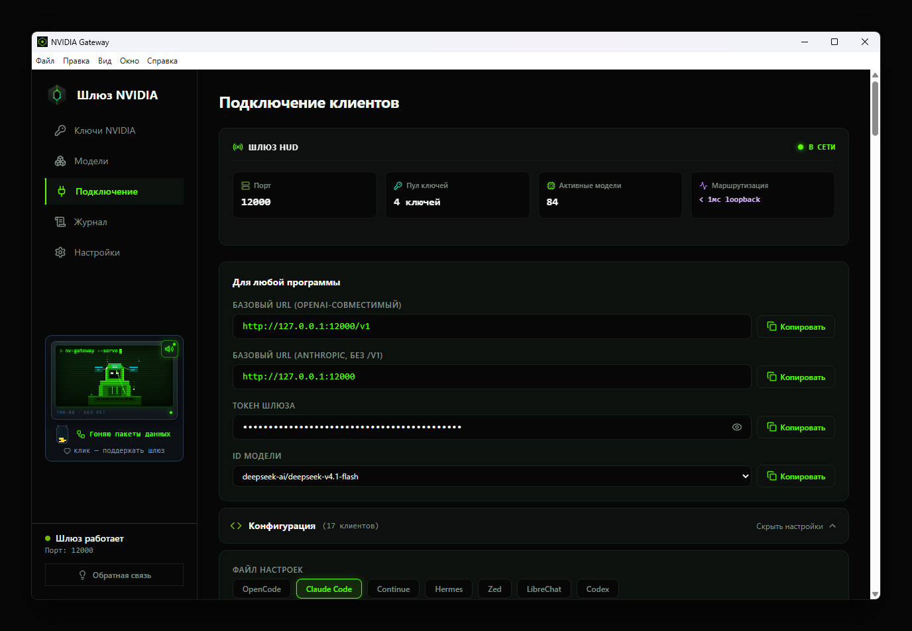

<p align="center">Русский · <a href="README.md">English</a></p>

<p align="center"><picture>
  <source media="(prefers-color-scheme: dark)" srcset="docs/assets/logo-dark.svg">
  </picture></p>

<h1 align="center">NV Gateway: OpenAI- и Anthropic-API для NVIDIA NIM</h1>

<p align="center">Бесплатное приложение для Windows: один локальный адрес <code>127.0.0.1:12000</code> для Claude Code, Cline, OpenCode и ещё 14 настроек.</p>

<p align="center"><b>Работает с вашими ключами NVIDIA Build (build.nvidia.com).</b></p>

<p align="center">
  <a href="https://github.com/HaYkMnE/NV-Gateway/releases/latest"></a>
  <a href="https://github.com/HaYkMnE/NV-Gateway/releases"></a>
  
  <a href="LICENSE"></a>
  <a href="https://scorecard.dev/viewer/?uri=github.com/HaYkMnE/NV-Gateway"></a>
</p>

<p align="center"><a href="https://github.com/HaYkMnE/NV-Gateway/releases/latest"></a></p>

**Рекомендуем: установка одной командой (без предупреждения браузера).** Вставьте в PowerShell:

```powershell
irm https://raw.githubusercontent.com/HaYkMnE/NV-Gateway/main/install.ps1 | iex
```

<sub>Установка из PowerShell пропускает предупреждение браузера о загрузке и окно SmartScreen. Microsoft Defender всё равно проверяет установщик. <a href="#установка">Другие способы установки</a></sub>

<p align="center"><b>Бесплатно и с открытым кодом (Apache-2.0)</b> · <b>Без прав администратора</b> · <b>Ключи хранятся на вашем ПК</b></p>

<p align="center"><sub>Windows 10 и новее · SHA256SUMS.txt в каждом релизе</sub></p>

<p align="center"><a href="#зачем-nv-gateway">Зачем</a> · <a href="#быстрый-старт-в-4-шага">Быстрый старт</a> · <a href="#установка">Установка</a> · <a href="#всё-что-внутри">Возможности</a> · <a href="#работает-с-вашими-инструментами">Совместимость</a> · <a href="#сравнение-с-альтернативами">Сравнение</a> · <a href="#приватность-что-и-куда-уходит">Приватность</a> · <a href="#открытый-код">Открытый код</a> · <a href="#частые-вопросы">Вопросы</a> · <a href="#разработчикам">Разработчикам</a> · <a href="README.md">English</a></p>

<p align="center"></p>

## Зачем NV Gateway

- **Один адрес для всех инструментов.** 17 готовых настроек: Claude Code, Cline, Roo Code, Kilo Code, OpenCode, Codex CLI, Copilot, Open WebUI и другие.
- **Лимит на одной модели не останавливает остальные.** Работает с одним ключом или с несколькими. NV Gateway учитывает лимиты отдельно для каждой модели: если ключ упёрся в лимит на одной модели, он остаётся доступен для других, а запрос уходит на другой ключ.
- **Три API на одном порту.** OpenAI Chat Completions, Anthropic Messages и OpenAI Responses на `127.0.0.1:12000`. Claude Code и Codex CLI подключаются напрямую.
- **Настоящие лимиты, а не догадки.** Для моделей с настроенным профилем `/v1/models` сообщает размер контекста и вывода (до 1 млн токенов), и инструмент перестаёт обрезать промпты.
- **Топовые модели NVIDIA, всегда актуальные.** Приложение обновляет каталог NVIDIA каждый день: новые модели появляются без обновления программы. Настроенные профили добавляют уровни рассуждений, изображения и вызовы инструментов там, где модель это умеет.
- **Локально и под защитой.** Слушает только 127.0.0.1, требует локальный токен, хранит ключи зашифрованными через Windows DPAPI и не пишет их в логи.
- **Без прав администратора.** Установка для текущего пользователя и мастер первого запуска. После сбоя перезапускается сам (до 3 попыток).
- **Бесплатно, с открытым кодом (Apache-2.0), без аккаунта у нас и без телеметрии.** 7 языков интерфейса. Обновления ставятся только с вашего согласия. Аккаунт NVIDIA для ключей всё равно нужен.

## Быстрый старт в 4 шага

1. **Установите** одной командой в PowerShell: `irm https://raw.githubusercontent.com/HaYkMnE/NV-Gateway/main/install.ps1 | iex`. Скрипт сверяет SHA256 установщика и ставит программу для текущего пользователя, без прав администратора. Удобнее скачать через браузер? См. раздел [Установка](#установка).
2. **Получите бесплатный ключ** на [build.nvidia.com](https://build.nvidia.com).
3. **Вставьте ключ** в мастере первого запуска, порт оставьте 12000.
4. **Укажите адрес** `http://127.0.0.1:12000/v1` в своём инструменте. Для Claude Code нужен `ANTHROPIC_BASE_URL=http://127.0.0.1:12000`, без `/v1`. В качестве API-ключа используйте токен шлюза с экрана **Endpoint**.

<p align="center"></p>

<p align="center"><a href="https://github.com/HaYkMnE/NV-Gateway/releases/latest"></a></p>

## Работает с вашими инструментами

Используйте порт, который показан в приложении (по умолчанию 12000). `<gateway-token>` — это токен с экрана **Endpoint**.

| Инструмент | Протокол | Базовый адрес |
|---|---|---|
| Claude Code | Anthropic Messages | `http://127.0.0.1:12000` (без `/v1`) |
| Codex CLI | OpenAI Responses | `http://127.0.0.1:12000/v1` |
| OpenCode | OpenAI Chat Completions | `http://127.0.0.1:12000/v1` |
| Cline / Roo Code | OpenAI Compatible | `http://127.0.0.1:12000/v1` |
| Aider | OpenAI Chat Completions | `http://127.0.0.1:12000/v1` |
| Continue | OpenAI Chat Completions | `http://127.0.0.1:12000/v1` |
| Windsurf / OpenClaw | OpenAI | `http://127.0.0.1:12000/v1` |
| Cursor | OpenAI | `http://127.0.0.1:12000/v1`. Нужны платный тариф Cursor и публичный туннель: Cursor не видит localhost. |

В приложении есть настройки ещё для 9 программ, среди них Kilo Code, Zed, GitHub Copilot и Open WebUI. Для OpenCode приложение может само записать конфиг в `~/.config/opencode/opencode.json`.

<details>
<summary>Claude Code</summary>

```powershell
$env:ANTHROPIC_BASE_URL = "http://127.0.0.1:12000"
$env:ANTHROPIC_AUTH_TOKEN = "<gateway-token>"
claude --model <model-id>
```

Bash/Zsh:

```bash
export ANTHROPIC_BASE_URL="http://127.0.0.1:12000"
export ANTHROPIC_AUTH_TOKEN="<gateway-token>"
claude --model <model-id>
```
</details>

<details>
<summary>Codex CLI (<code>%USERPROFILE%\.codex\config.toml</code>)</summary>

```toml
model = "<model-id>"
model_provider = "nv-gateway"

[model_providers.nv-gateway]
name = "NV-Gateway"
base_url = "http://127.0.0.1:12000/v1"
env_key = "NV_GATEWAY_TOKEN"
wire_api = "responses"
```

Затем задайте `$env:NV_GATEWAY_TOKEN = "<gateway-token>"` и запустите `codex`.
</details>

<details>
<summary>Aider</summary>

```powershell
$env:OPENAI_API_BASE = "http://127.0.0.1:12000/v1"
$env:OPENAI_API_KEY  = "<gateway-token>"
aider --model openai/<model-id>
```

Bash/Zsh:

```bash
export OPENAI_API_BASE="http://127.0.0.1:12000/v1"
export OPENAI_API_KEY="<gateway-token>"
aider --model openai/<model-id>
```
</details>

Вместо `<model-id>` подставьте любую модель с экрана **Models** в приложении. Актуальный список инструмент может получить и сам через `GET /v1/models`.

<p align="center"></p>

## Всё, что внутри

<details>
<summary><b>Ключи</b></summary>

- **Лимит на одной модели не блокирует ключ для остальных.** Учёт ключей по моделям.
- **Неверный ключ не попадёт в список.** Каждый ключ проверяется у NVIDIA при добавлении.
- **Видно, как работает каждый ключ.** Счётчики успехов, ошибок и токенов по каждому ключу.
- **Ключ можно приостановить, не удаляя.** Переключатель вкл/выкл для каждого ключа.
- **Видно, какие модели доступны вашим ключам.** На карточке модели показано, сколько ваших ключей могут её использовать.

</details>

<details>
<summary><b>Модели</b></summary>

**Возможности, если модель их поддерживает:** Рассуждения · Изображения · Вызов инструментов · Длинный контекст

- **Новые модели NVIDIA появляются без обновления приложения.** Каталог обновляется каждые 24 часа.
- **Сильные модели — первыми.** Сортировка по силе (Top Rated, по данным LLM Stats), популярности, имени или дате обновления.
- **Только то, чем можно пользоваться.** Фильтры: модели с бесплатным эндпоинтом или доступные для скачивания.
- **Главное — с одного взгляда.** Значки показывают флаги NVIDIA: бесплатный эндпоинт и доступность для скачивания.
- **Видно, насколько свежа запись.** Значок возраста показывает, когда NVIDIA последний раз обновляла модель в каталоге.
- **Модель находится по паре букв.** Поиск, Ctrl+K сразу переводит в него.
- **Подробности без выхода из приложения.** В панели «Подробнее» — возможности, доступность, дата обновления и популярность.
- **Проверка модели без клиента.** Скопируйте готовую команду cURL.
- **Короткий список моделей в инструментах.** Отключённая модель исчезает из `/v1/models`.
- **Время ожидания — под каждую модель.** «День» ждёт первый байт до 300 с, «Ночь» — 120 с, «Авто» выбирает по недавним тайм-аутам и ошибкам потока.

</details>

<details>
<summary><b>Клиенты и API</b></summary>

- **17 настроек клиентов на одном экране.** Готовые настройки с кнопками копирования адреса, токена и ID модели.
- **Конфиг OpenCode не нужно править руками.** Приложение записывает его само, с лимитами и флагом рассуждений каждой модели.
- **Три API на одном порту.** OpenAI Chat Completions, Anthropic Messages и OpenAI Responses.
- **Настройка thinking в Claude Code просто работает.** Она переводится в уровень рассуждений модели, а если модель не умеет рассуждать, запрос понятно отклоняется.
- **Расход токенов виден и при потоковой передаче.** Потоковые ответы сообщают расход токенов в конце.
- **Инструмент перестаёт обрезать промпты.** `/v1/models` сообщает лимиты контекста и вывода для моделей с настроенным профилем (до 1 млн токенов).

</details>

<details>
<summary><b>Надёжность</b></summary>

- **Запрос не висит бесконечно.** Задайте общий лимит времени на запрос; по истечении приходит понятная ошибка тайм-аута.
- **После сбоя поднимается сам.** До 3 автоматических перезапусков.
- **Оборванный ответ не выдаётся за полный.** Прерванный поток от NVIDIA завершается ошибкой.
- **Видно, куда уходит время.** В журнале есть длительность каждого запроса, список ошибок можно просмотреть и отправить.
- **Проблему можно описать одним файлом.** Диагностический файл для приложения к issue.

</details>

<details>
<summary><b>Приватность и безопасность</b></summary>

- **Из сети до него не добраться.** Слушает только 127.0.0.1.
- **Пользоваться могут только ваши программы.** Запросы требуют локальный токен шлюза.
- **Ключи на диске зашифрованы.** Windows DPAPI; ключи и токены вычищаются из логов.
- **Подменённое приложение не запустится.** Проверка целостности ASAR в собранном приложении.
- **О вас ничего не собирается.** Без телеметрии и аналитики.

</details>

<details>
<summary><b>На каждый день</b></summary>

- **Не мешает работать.** Живёт в системном трее и может запускаться вместе с Windows.
- **На вашем языке.** 7 языков интерфейса, для арабского — раскладка справа налево.
- **Настройки осваиваются по ходу дела.** Маленький питомец в боковой панели подсказывает реальные настройки. Подсказки можно отключить.
- **Обновление — когда решите вы.** Приложение предлагает обновление и ставит его только после согласия.
- **Поддержать проект — по желанию.** Необязательный донат в криптовалюте.

</details>

## Сравнение с альтернативами

По описаниям в README каждого проекта, проверено 29.10.2026.

| | NV Gateway | NVIDIA API напрямую | LiteLLM | Docker-прокси для NIM (например, nim-proxy) |
|---|---|---|---|---|
| Установка | установщик Windows + интерфейс | не нужна (HTTP) | pip / Docker | Docker |
| Установка без прав администратора | да | н/п | — | — |
| Anthropic `/v1/messages` для Claude Code | да | нет | да | по-разному |
| Несколько ключей с переключением | да | нет, один ключ на запрос | да (конфиг) | да (nim-proxy) |
| Пул ключей в графическом интерфейсе | да, десктоп-приложение | н/п | — | веб-интерфейс в Docker (nim-proxy) |
| Лимиты учитываются по паре «модель + ключ» | да | н/п | — | — |
| Лимиты моделей для инструментов | да, для настроенных профилей | н/п | конфиг | не указано |
| Только 127.0.0.1, ключи зашифрованы DPAPI | да | н/п | — | — |
| Языки интерфейса | 7 | н/п | — | — |
| Открытый код | ✓ Apache-2.0 | н/п | ✓ | ✓ |
| Цена | бесплатно | бесплатный тариф | бесплатно | бесплатно |
| Провайдеры | только NVIDIA | NVIDIA | 100+ провайдеров | NVIDIA |

<sub>н/п — неприменимо. — = в их README не заявлено на 29.10.2026.</sub>

## Как это работает

<p align="center"></p>

Инструмент отправляет запрос на `127.0.0.1:12000`. NV Gateway при необходимости переводит его в нужный формат, подставляет один из ваших ключей NVIDIA и отправляет в API NVIDIA. Если ключ ограничен на этой модели или выдаёт ошибку, запрос уходит на другой ключ. Ответ приходит потоком в том формате, который ждёт ваш инструмент.

## Приватность: что и куда уходит

Промпты уходят только в NVIDIA. Телеметрии и аналитики в NV Gateway нет. Полный список — в [PRIVACY.ru.md](PRIVACY.ru.md).

| Куда | Что отправляется | Когда | Можно отключить? |
|---|---|---|---|
| NVIDIA (`integrate.api.nvidia.com`) | Ваши промпты с одним из ваших ключей; запросы списка моделей; короткие проверки возможностей | Когда инструмент шлёт запрос, при запуске и при добавлении ключа | Нет, ради этого приложение и работает |
| NVIDIA (`api.ngc.nvidia.com`) | Запрос публичных данных каталога, без ключа | При запуске и после истечения 24-часового кэша | Нет |
| GitHub (`HaYkMnE/NV-Gateway`) | Проверка обновлений | При запуске и каждые 6 часов | Ничего не скачивается без вашего согласия |
| `api.zeroeval.com` (рейтинг моделей) | Простой запрос без ключа и без ID моделей. Сервис видит ваш IP-адрес | Не чаще раза в 24 часа. **Включено по умолчанию** | Да: Настройки → Model ranking (LLM Stats) |
| Отчёты об ошибках (`nv-gateway-reports.nvgw-sys.workers.dev`) | Очищенный список ошибок и версия приложения | Только когда вы нажимаете **Отправить** | Без нажатия не отправляется никогда |

Ключи хранятся зашифрованными через Windows DPAPI в `%APPDATA%\NV-Gateway\keys.json`. Если шифрование Windows недоступно, приложение откажется сохранять ключи, а не запишет их открытым текстом.

## Установка

**А. Одной командой (рекомендуем).** Откройте PowerShell (права администратора не нужны) и выполните:

```powershell
irm https://raw.githubusercontent.com/HaYkMnE/NV-Gateway/main/install.ps1 | iex
```

Скрипт скачивает последний установщик и `SHA256SUMS.txt` со страницы релизов, останавливается, если SHA256 не совпал, ставит программу только для текущего пользователя (`/S /currentuser`) и удаляет свои временные файлы. Прав администратора он не просит и настройки безопасности не меняет. [Посмотреть скрипт](https://github.com/HaYkMnE/NV-Gateway/blob/main/install.ps1).

**Б. Сначала прочитать скрипт.**

```powershell
irm https://raw.githubusercontent.com/HaYkMnE/NV-Gateway/main/install.ps1 -OutFile install.ps1
notepad install.ps1
powershell -NoProfile -ExecutionPolicy Bypass -File .\install.ps1
```

`-ExecutionPolicy Bypass` действует только на этот один процесс PowerShell и не меняет сохранённую политику. Он нужен потому, что на многих ПК с Windows действует политика Restricted, которая блокирует локальные скрипты.

**В. Скачать .exe через браузер.** Возьмите `NV-Gateway-Setup-<версия>.exe` из [последнего релиза](https://github.com/HaYkMnE/NV-Gateway/releases/latest), [проверьте файл](#проверка-файла-sha256) и выполните шаги для SmartScreen ниже.

Установка из PowerShell пропускает предупреждение браузера о загрузке и окно SmartScreen. Microsoft Defender всё равно проверяет установщик. Если в Windows 11 включён Smart App Control, Windows всё равно может заблокировать неподписанный установщик, каким бы способом вы его ни ставили. Контрольная сумма лежит в том же релизе, поэтому она ловит повреждённый или подменённый при загрузке файл, но не взломанный релиз.

Другие способы, включая ручной путь через `curl.exe`: [INSTALL.ru.md](INSTALL.ru.md).

## «Система Windows защитила ваш компьютер»?

Это окно появляется, когда вы запускаете `.exe`, скачанный через браузер (вариант В выше).

Установщик не подписан сертификатом, поэтому SmartScreen показывает «Система Windows защитила ваш компьютер» и «Неизвестный издатель». У неподписанных файлов нет репутации, и для каждой новой версии предупреждение появится снова.

1. Сначала [проверьте файл](#проверка-файла-sha256).
2. Нажмите **Подробнее**.
3. Нажмите **Выполнить в любом случае**.

Некоторые антивирусы могут ругаться на приложение по той же причине. Скачивайте его только со [страницы релизов](https://github.com/HaYkMnE/NV-Gateway/releases).

## Проверка файла (SHA256)

В каждом релизе лежит `SHA256SUMS.txt`. Скачайте его из того же релиза, что и установщик, в ту же папку.

1. Откройте PowerShell в этой папке.
2. Выведите хеш установщика:

   ```powershell
   Get-FileHash .\NV-Gateway-Setup-*.exe -Algorithm SHA256
   ```

3. Сравните его со строкой для этого файла в `SHA256SUMS.txt`. Регистр букв не важен.

Автоматическое сравнение (в папке должен лежать только один установщик):

```powershell
$exe = Get-Item .\NV-Gateway-Setup-*.exe | Select-Object -First 1
$expected = ((Select-String -Path .\SHA256SUMS.txt -Pattern ([regex]::Escape($exe.Name) + '$')).Line -split '\s+')[0]
(Get-FileHash $exe.FullName -Algorithm SHA256).Hash -eq $expected
```

`True` — файл совпадает. Если видите `False`, удалите файл и скачайте заново со страницы релизов.

## Открытый код

NV Gateway бесплатен и распространяется с открытым кодом по [лицензии Apache 2.0](LICENSE). Всё приложение лежит в этом репозитории, поэтому любой может проверить, что ключи остаются на вашем ПК: хранение ключей — в [`src/main/secure-state.ts`](src/main/secure-state.ts), все сетевые обращения перечислены в [PRIVACY.ru.md](PRIVACY.ru.md).

- **Релизы собираются из этого кода.** Все релизы собирает GitHub Actions из этого репозитория ([workflow релиза](.github/workflows/release.yml)).
- **Контрольные суммы.** В каждом релизе есть `SHA256SUMS.txt` для установщика, его blockmap, `latest.yml` и портативного zip. См. [Проверка файла](#проверка-файла-sha256).
- **Лицензия простыми словами.** NV Gateway можно бесплатно использовать, изменять и распространять, в том числе в коммерческих целях, если вы прикладываете лицензию и файл NOTICE и отмечаете изменённые файлы. Apache-2.0 не даёт права использовать название «NV Gateway» и его логотип, кроме как для указания происхождения программы. Пожалуйста, публикуйте форки под другим названием. Полные условия (на английском): [LICENSE](LICENSE), [NOTICE](NOTICE), [THIRD-PARTY-NOTICES.txt](THIRD-PARTY-NOTICES.txt).

## Частые вопросы

<details>
<summary><b>Как бесплатно подключить Claude Code к NVIDIA NIM?</b></summary>

Задайте `ANTHROPIC_BASE_URL=http://127.0.0.1:12000` (без `/v1`) и `ANTHROPIC_AUTH_TOKEN` с токеном шлюза, затем запустите `claude --model <model-id>`. У API NVIDIA нет маршрута Anthropic, поэтому напрямую Claude Code не встаёт: NV Gateway переводит для него запросы Anthropic Messages. Нужен бесплатный ключ NVIDIA с build.nvidia.com.
</details>

<details>
<summary><b>Как настроить ключ NVIDIA API в Cline или Roo Code?</b></summary>

Выберите провайдера **OpenAI Compatible**, укажите Base URL `http://127.0.0.1:12000/v1` и вставьте токен шлюза как API-ключ. Сами ключи NVIDIA остаются в NV Gateway. Затем введите ID модели с экрана **Models** в приложении.
</details>

<details>
<summary><b>Почему Cursor не работает с ключом NVIDIA?</b></summary>

Cursor не может обратиться к `localhost`, поэтому ему нужны платный тариф Cursor и публичный туннель к шлюзу. Остальные инструменты из списка подключаются к `127.0.0.1` напрямую.
</details>

<details>
<summary><b>Что значит «429 Too Many Requests» на build.nvidia.com?</b></summary>

NVIDIA ограничила частоту запросов для этого ключа. Лимиты действуют на каждый ключ, единой опубликованной цифры нет. По отзывам сообщества это около 40 запросов в минуту, в зависимости от модели ([форум NVIDIA](https://forums.developer.nvidia.com/t/request-for-nvidia-build-api-rate-limit-increase-40-rpm-200-rpm/377433)). Если ключей несколько, запрос уйдёт на другой ключ, а ограниченный ключ останется доступен для других моделей. Когда ограничены все ключи, запросы завершаются ошибкой, пока лимит не сбросится.
</details>

<details>
<summary><b>Можно ли использовать несколько ключей NVIDIA API?</b></summary>

Да. Работает с одним ключом или с несколькими. NV Gateway учитывает лимиты отдельно для каждой модели: если ключ упёрся в лимит на одной модели, он остаётся доступен для других, а запрос уходит на другой ключ. Вы сами отвечаете за то, чтобы использовать ключи в соответствии с условиями NVIDIA.
</details>

<details>
<summary><b>Блокирует ли один ограниченный ключ остальные?</b></summary>

Нет. Лимит учитывается для этого ключа только на одной модели, поэтому для других моделей ключ продолжает работать, а запрос уходит на другой ключ. Ключ, который NVIDIA отклоняет, у которого закончились кредиты или который возвращает ошибки сервера, приостанавливается для всех моделей, пока не восстановится.
</details>

<details>
<summary><b>Можно ли отключить модель или ключ?</b></summary>

Да, и то и другое. Ключ отключается на экране ключей без удаления. Модель отключается на экране моделей и пропадает из списка моделей в ваших инструментах при следующем запросе.
</details>

<details>
<summary><b>Как появляются новые модели NVIDIA?</b></summary>

Сами. NV Gateway обновляет каталог NVIDIA каждые 24 часа, так что новые модели появляются без обновления приложения. Значок возраста на каждой модели показывает, когда NVIDIA последний раз её обновляла.
</details>

<details>
<summary><b>Какие модели можно использовать?</b></summary>

Любую модель из каталога NVIDIA. Актуальный список показывает приложение, и его же возвращает `GET /v1/models`. NVIDIA со временем добавляет и снимает модели.
</details>

<details>
<summary><b>Можно ли проверить код или собрать приложение самому?</b></summary>

Да. NV Gateway распространяется с открытым кодом по лицензии Apache-2.0, весь код лежит в этом репозитории. Можно посмотреть, как хранятся ключи ([`src/main/secure-state.ts`](src/main/secure-state.ts)), проверить все сетевые обращения ([PRIVACY.ru.md](PRIVACY.ru.md)) и собрать приложение самому ([Сборка из исходников](#сборка-из-исходников)). Все релизы собирает GitHub Actions из этого репозитория.
</details>

<details>
<summary><b>Обновление с 0.x: почему приложение перестало обновляться?</b></summary>

Установки 0.x проверяют обновления по старому адресу и сами не обновятся. Один раз переустановите приложение однострочной командой из [INSTALL.ru.md](INSTALL.ru.md#способ-1-рекомендуется-одна-команда). Настройки и ключи сохранятся.
</details>

<details>
<summary><b>Отправляет ли NV Gateway промпты или ключи куда-то ещё?</b></summary>

Нет. Промпты и ключи уходят только в NVIDIA. Ещё приложение проверяет обновления на GitHub, запрашивает рейтинг моделей у `api.zeroeval.com` (без ключа и ID моделей, отключается) и отправляет отчёт об ошибке, только если вы нажали «Отправить». Подробности — в [PRIVACY.ru.md](PRIVACY.ru.md).
</details>

<details>
<summary><b>Почему Windows или антивирус предупреждают об установщике?</b></summary>

Потому что установщик не подписан. NV Gateway — бесплатный проект без платного сертификата подписи кода, поэтому у Windows нет репутации его издателя, и каждая новая версия начинает с нуля. Чтобы проверить файл, сравните его SHA256 с `SHA256SUMS.txt` из того же релиза ([шаги](#проверка-файла-sha256)). Чтобы обойтись без предупреждений браузера и SmartScreen, установите программу [командой PowerShell](#установка); Microsoft Defender всё равно проверит установщик. Если в Windows 11 включён Smart App Control, Windows может заблокировать неподписанный установщик при любом способе установки. Если Defender пометил файл и вы считаете это ложным срабатыванием, его можно отправить в Microsoft: https://www.microsoft.com/wdsi/filesubmission/.
</details>

<details>
<summary><b>Какой порт использует NV Gateway и можно ли его сменить?</b></summary>

12000 для API и 12001 для служебного порта, он всегда на единицу больше. Порт выбирается в мастере первого запуска. Позже **Настройки → Change port** откроет тот же шаг.
</details>

<details>
<summary><b>Работает ли NV Gateway на macOS или Linux?</b></summary>

Нет. Только Windows 10 и новее.
</details>

<details>
<summary><b>Как полностью удалить NV Gateway?</b></summary>

Откройте **Параметры Windows → Приложения → NV-Gateway → Удалить**. Удалятся программа и запись автозапуска. Зашифрованные ключи, настройки и логи остаются в `%APPDATA%\NV-Gateway`, чтобы переустановка их сохранила. Чтобы стереть и их, удалите эту папку после деинсталляции.
</details>

<details>
<summary><b>Нужен ли аккаунт NVIDIA?</b></summary>

Да, аккаунт NVIDIA нужен, чтобы получить ключи на build.nvidia.com. Своего аккаунта и регистрации у NV Gateway нет.
</details>

## Честные ограничения

- Только Windows (Windows 10 и новее).
- Установщик не подписан, SmartScreen предупреждает о каждой новой версии.
- Действуют лимиты бесплатного тарифа NVIDIA. Когда ограничены все ключи, запросы завершаются ошибкой.
- Вы сами отвечаете за то, чтобы использовать ключи в соответствии с условиями NVIDIA.
- NVIDIA может снять модель в любой момент; приложение продолжает работать с остальным каталогом.
- Если в Windows 11 включён Smart App Control, Windows может заблокировать неподписанный установщик при любом способе установки.
- Модель, которая постоянно сбоит, автоматически не скрывается и не помечается.
- Cursor требует платного тарифа и публичного туннеля.
- Опубликованных замеров производительности нет.

<p align="center"><a href="https://github.com/HaYkMnE/NV-Gateway/releases/latest"></a></p>

## Разработчикам

### Сборка из исходников

Нужны Windows, Git и Node.js 22.12 или новее.

```powershell
git clone https://github.com/HaYkMnE/NV-Gateway.git
cd NV-Gateway
npm ci
npx install-electron --no
npm run build
npm test
```

Чтобы собрать приложение и прогнать проверки упаковки, сначала задайте владельца релизов:

```powershell
$env:NVGW_GH_OWNER = "HaYkMnE"
npm run package:dir
```

Режим разработки, пример конфига и справочник локального API — в [DEVELOPMENT.md](DEVELOPMENT.md) (на английском). Перед изменениями прочитайте [AGENTS.md](AGENTS.md).

## Участие в разработке

Сообщения об ошибках, исправления и переводы приветствуются. Прочитайте [CONTRIBUTING.md](.github/CONTRIBUTING.md) и [AGENTS.md](AGENTS.md), запустите `npm test` перед pull request и никогда не коммитьте ключи и токены.

## Безопасность

Об уязвимостях сообщайте приватно через GitHub private vulnerability reporting в этом репозитории: [сообщить об уязвимости](https://github.com/HaYkMnE/NV-Gateway/security/advisories/new). Не создавайте для этого публичный issue. Подробности — в [SECURITY.md](.github/SECURITY.md).

## Изменения · Поддержка · Лицензия

- **Изменения:** [CHANGELOG.md](CHANGELOG.md) и [заметки к релизам](https://github.com/HaYkMnE/NV-Gateway/releases).
- **Поддержка:** [создайте issue](https://github.com/HaYkMnE/NV-Gateway/issues). Уберите ключи и токены из логов, которые прикладываете.
- **Лицензия:** бесплатно, открытый код по [Apache-2.0](LICENSE). См. [NOTICE](NOTICE) и [THIRD-PARTY-NOTICES.txt](THIRD-PARTY-NOTICES.txt). Название «NV Gateway» и логотип под лицензию не входят.

<sub>NV Gateway — неофициальная независимая программа. Она не создана, не одобрена и не поддерживается NVIDIA. NVIDIA и NIM — товарные знаки NVIDIA Corporation.</sub>
